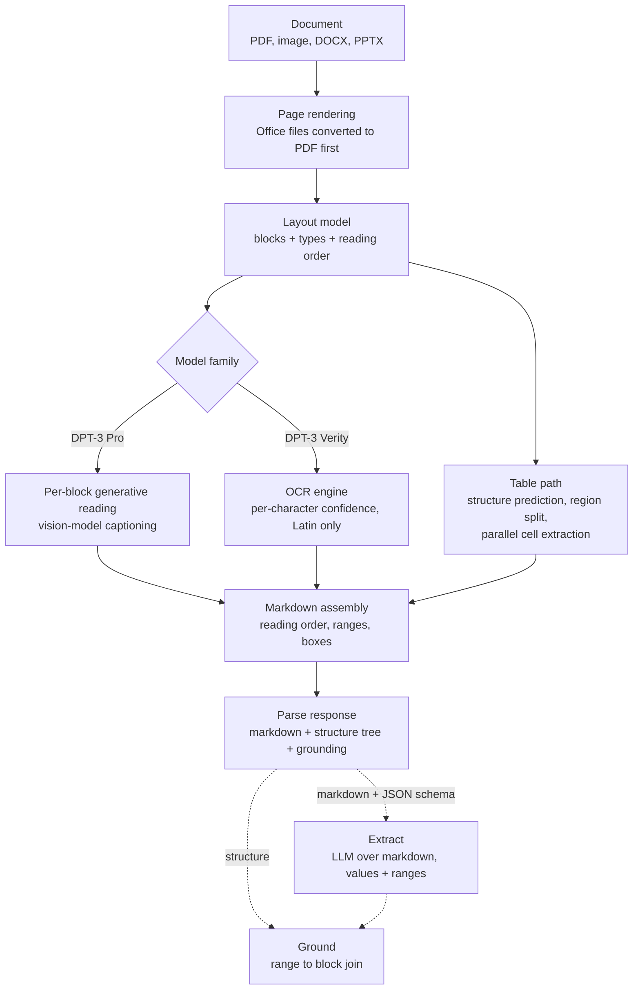

Guide
{ .eyebrow }

# How DPT-3 works

An evidence-graded reconstruction of LandingAI's Document Pre-trained Transformer 3, built only from what LandingAI has published: docs, the OpenAPI spec, changelogs, blogs, and open-source repos.
{ .lead }

!!! warning "What can and cannot be known"
    LandingAI has published no paper, model card, weights or architecture diagram for DPT-1, DPT-2 or DPT-3. Nobody outside the company can state the model internals. What *can* be reconstructed with confidence is the **shape of the pipeline** and the **division of labour between its stages**, because the API surface, the pricing, the failure modes and the changelog all leak structure. Every claim below carries a chip:
    Documented LandingAI says it, with a link.
    Implied follows from documented behaviour; the reasoning is shown.
    Unknown not publicly knowable.

## The pipeline in one picture

The solid path is what the Parse API does. The dotted path is the two follow-on APIs. The next sections grade each box.

## Stage by stage

### 1. Input normalisation

Documented
Parse accepts PDFs, images, and modern Office files (DOCX, PPTX, ODT, RTF). "Office files are converted to PDF before parsing; the conversion can change layout and page count, and page-based limits and credits apply to the converted PDF's page count." Spreadsheets and legacy DOC/PPT are Gen1-only. Password-protected PDFs are rejected with HTTP 422 in Gen2.

Sources: [Supported file types](https://docs.landing.ai/dpt3/file-types), the [ADE agent skill](https://github.com/landing-ai/ade-document-processing-skills/blob/main/plugins/ade-document-processing/skills/document-extraction/SKILL.md).

For a slide pipeline this matters: **ADE never sees the PPTX text layer**. It rasterises the deck and reads pixels. That is a property we can beat, not merely match (see the [pipeline](../build/pipeline.md#stage-1-render-and-harvest)).

### 2. Layout detection and block ontology

Documented
"A Document Pre-Trained Transformer (DPT) is the model that powers the Parse API. The model identifies a document's layout, transcribes the content into Markdown in reading order, and records where every block sits on the page." The Gen1 docs describe DPT-2 the same way: "identifies document layouts and chunks, then generates descriptive explanations (captions) for those chunks."

The block ontology is fixed and enumerated in the OpenAPI spec: `text`, `table`, `table_cell`, `figure`, `marginalia`, `attestation`, `logo`, `card`, `scan_code`. Each block gets an id `<type>-<index>` assigned in reading order, a page number, a `[start, end)` range into the markdown, and a box in normalised page coordinates. Pages whose layout pass fails are returned with `status: failed` and an empty child list, which tells you layout is a per-page operation with its own failure mode.

Figures additionally carry a classification label (`CHART`, `FLOWCHART`, `DIAGRAM`, `ILLUSTRATION`, `PHOTOGRAPH`, `FIGURE`), attestations a state label (`SIGNED`, `E-SIGNED`, `STAMPED`, `SEALED`), checkboxes are standardised to `[X]` / `[]`.

Sources: [Parsing models](https://docs.landing.ai/dpt3/parse-models), [Parse API response](https://docs.landing.ai/dpt3/parse-response), [OpenAPI spec](https://docs.landing.ai/dpt3/openapi-adev2.json), [Gen1 parsing models](https://docs.landing.ai/ade/ade-parse-models).

Implied The DPT-2 announcement credits "smarter layout detection" that "misses fewer chunks, including in messy scans, and can detect stamps inside tables and process them separately." Detecting a stamp *inside* a table and routing it separately is detector behaviour, not language-model behaviour. The layout stage is almost certainly a dedicated vision detector (the family of DocLayout-YOLO, RT-DETR, PP-DocLayout), not the generative model.

Unknown The detector architecture, its training data, and whether reading order is predicted by the detector or by a separate ordering model.

### 3. Per-block reading: two engines behind one endpoint

Documented
This is the most informative part of the public record. The OpenAPI description of the `model` field reads:

> Two families are available: `dpt-3-pro` for highest quality, and `dpt-3-verity` for lower-latency parsing **without vision-model captioning**.

And the `confidence` field:

> Present only on word-granularity `atomic_grounding` entries (`dpt-3-verity`), where it is **the lowest per-character OCR confidence in the word**, so a word is only as trustworthy as its weakest character. Omitted on node-level grounding and on models that ground at line granularity.

The capability table in the docs completes the picture:

| Capability | DPT-3 Verity | DPT-3 Pro |
|---|---|---|
| Scanned documents and handwriting | No | Yes |
| Non-Latin scripts and math formulas | No | Yes |
| Key-value pairs and form layouts | Less accurate | Yes |
| Figure descriptions | Basic | Detailed |
| Markdown formatting (headings, bold, italics) | No | Yes |
| Atomic grounding granularity | Word | Line |
| Confidence scores | Word level | No |

Sources: [OpenAPI spec](https://docs.landing.ai/dpt3/openapi-adev2.json), [Parsing models](https://docs.landing.ai/dpt3/parse-models), [Supported languages](https://docs.landing.ai/ade/ade-languages) ("DPT-3 Verity reads Latin-script documents only"; Korean is in the strong-support tier for DPT-2 and DPT-3 Pro).

Implied Put together, the two families are two different reading engines sharing the layout stage and the output assembler:

- **Verity is a conventional OCR engine.** Per-character confidence, word boxes, deterministic transcription, Latin-only, no handwriting, no styling, "renders visual content as generic markers such as `[VISUAL_TEXT]`." Every one of these is the signature of a text-detection plus text-recognition OCR stack, where confidence is a softmax over characters. LandingAI's own word for its output is "transcribes deterministically."
- **Pro is a generative vision-language model reading each block.** It handles non-Latin scripts, handwriting and math, writes "detailed figure descriptions," emits heading and bold formatting, grounds only at the line level, and has **no** confidence score. Generative decoders do not produce a calibrated per-character score, which is exactly why Pro cannot offer one and why the Gen1 confidence feature disappeared the moment the underlying provider changed (see stage 7).

Implied "Captioning" is LandingAI's word for generating a block's markdown, including text blocks. The Playground's Config menu lets you "choose which element types to caption," and the Gen2 options expose `blocks.<type>.markdown: false` per block type, which "suppresses" that type's markdown and empties its `atomic_grounding`. If the markdown of a text block can be switched off per type without affecting the layout tree, the layout tree is produced first and the markdown is generated afterwards, block by block.

### 4. The table path

Documented
The DPT-2 table blog is the only place LandingAI describes an internal algorithm:

1. **Structure prediction.** "DPT-2 first maps the table's layout, finding where rows, columns, and merged cells begin and end."
2. **Region split.** "It then splits the table into smaller regions," which the post says "reduces shifted cells and hallucinated rows."
3. **Parallel cell extraction.** "Each cell's contents are extracted and paired with a bounding box. Because regions are processed independently, extraction can run in parallel."
4. **Cell grounding.** The SDK returns `tableCell` groundings with page and box; Gen2 nests `table_cell` elements with 0-indexed `row`, `col`, `rowspan`, `colspan` under the `table` node.

The product name for this is "Agentic Table Captioning." Tables are emitted as HTML by default because "HTML preserves merged cells and nested layouts that pipe syntax cannot represent."

Sources: [Breakthrough table extraction with DPT-2](https://landing.ai/blog/breakthrough-table-extraction-with-dpt-2-agentic-document-extraction-by-landingai), [Gen2 changelog](https://docs.landing.ai/dpt3/changelog).

Implied This is the one concrete instance of the "decompose into bounded subtasks" behaviour that the marketing calls agentic: a structure model proposes a grid, the grid is cut into regions small enough for the reader to get right, the reader runs on each region, and the results are stitched back with their boxes. The same recipe is what the open-source literature calls *decomposition repair* ([research survey](../research/survey.md#agentic-repair-loops)).

### 5. Markdown assembly and grounding

Documented
The response is one markdown string in reading order plus a tree. Every node's `grounding.range` is a code-point offset into that one string, pages are separated by `<!-- PAGE BREAK -->`, figures become `<figure type="CHART">` elements whose generated text sits inside `<description>` tags, and the last line is `<!-- doc_id=<job_id> -->` so that Extract can link back to the parse job.

Ranges are "stable within a response but not across re-parses of the same document," and the skill file warns that "ranges shift between parses, even of the same file." Billing is "by output characters returned, not by page."

Sources: [Parse API response](https://docs.landing.ai/dpt3/parse-response), [Introducing ADE Gen2](https://landing.ai/blog/introducing-agentic-document-extraction-gen2), [ADE agent skill](https://github.com/landing-ai/ade-document-processing-skills).

Implied Non-deterministic ranges across re-parses of the same file are what you get from a generative reader, not from an OCR engine. Billing by output characters is what you do when your cost is dominated by decoder tokens. Both point the same way as stage 3.

### 6. Extract and Ground are separate models

Documented
Extract takes **markdown from any source** plus a JSON Schema whose field descriptions "guide the extraction, so treat them as prompts." It has its own snapshot line (`extract-latest`, `extract-20260903`), its own billing basis (input markdown characters plus output extraction characters), returns `null` for fields it cannot find and `ranges: null` for values it "synthesized." Ground is "always synchronous, consumes no credits," and maps ranges to the blocks they overlap; a mismatched parse/extract pair "returns 200 with plausible boxes that land on the wrong content."

Sources: [Extract](https://docs.landing.ai/dpt3/extract), [Ground](https://docs.landing.ai/dpt3/ground), [OpenAPI spec](https://docs.landing.ai/dpt3/openapi-adev2.json).

Implied Extract is a large language model prompted with the markdown and the schema, asked to return values with citations into the input string. Ground is a server-side range intersection over the structure tree, which is why it is free, synchronous, and cannot detect a mismatched pair. LandingAI's own DocVQA benchmark repo follows the same pattern in the open: parse with DPT-2, then answer questions with Claude Sonnet 4.5 over the parsed JSON, reaching 99.156% on the validation split.

Source: [ade-docvqa-benchmark](https://github.com/landing-ai/ade-docvqa-benchmark).

### 7. Third-party models inside DPT

Documented
Two changelog entries are unusually candid:

- **September 11, 2026.** "New snapshots of DPT-2, ADE Extract, and ADE Split run on an updated underlying model. One of our third-party model providers is retiring the model that earlier snapshots use." The replacement snapshot `dpt-2-20260903` "does not return confidence scores. The `confidence` field in the Parse response is `null`."
- **February 2026.** "One of our underlying solution providers for DPT-1 is upgrading their technology on February 17, 2026. While DPT-1 will continue to function, table parsing behavior and results may change for some documents."

Source: [ADE changelog](https://docs.landing.ai/ade/ade-changelog).

Implied DPT-1 and DPT-2 were orchestrations around external models, with at least the generative reading and the Extract model supplied by a third party. The confidence scores that Gen1 shipped in February 2026 (block and cell level, 0.95 review threshold "used internally to evaluate parsing quality") were tied to the retired provider's model and vanished with it. Whether DPT-3 Pro still uses a third-party VLM, a fine-tuned open model, or an in-house model is Unknown. The pattern is consistent with the rest of the industry: Reducto, for example, states that it "orchestrates 12+ models" ([survey](../research/survey.md#vendor-architectures)).

### 8. What "agentic" means in this system

LandingAI's product pages say ADE is an "agentic system that plans and executes" and that "agentic orchestration adapts to each document. Planning, deciding, and verifying until quality thresholds are met." The DeepLearning.AI write-up says ADE "iteratively decomposes complex documents into smaller sections for careful examination," and gives the table case as the example: extract a table, then extract its structure, then its cells.

Sources: [landing.ai/ade/parse](https://landing.ai/ade/parse), [landing.ai](https://landing.ai/), [The Batch](https://www.deeplearning.ai/the-batch/how-to-liberate-data-from-large-complex-pdfs).

Graded:

| Claim | Grade | Basis |
|---|---|---|
| Documents are decomposed into bounded subtasks (page, block, table region, cell) | Documented | Table blog, Batch article, per-page failure status |
| Subtasks run in parallel | Documented | Table blog ("regions are processed independently, extraction can run in parallel") |
| Outputs are checked against a quality threshold | Implied | Gen1 confidence docs: "0.95 is the threshold used internally to evaluate parsing quality" |
| Failed subtasks are re-planned and retried | Unknown | Only secondary sources say so; LandingAI's docs never describe a retry |
| An LLM "plans" the parse per document | Unknown | No documented parameter, latency signature or billing line suggests a planning step |

The honest reading: "agentic" in ADE is **structured decomposition with per-piece verification**, in the sense of a pipeline that knows how to cut hard regions into easy ones, not an autonomous agent choosing tools at runtime.

## Version timeline

| Date | Event | Source |
|---|---|---|
| 2025, early | DPT-1 in production; legacy `agentic-doc` library and `v1/tools/agentic-document-analysis` endpoint | [changelog](https://docs.landing.ai/ade/ade-changelog) |
| 2025-09-30 | DPT-2 announced: agentic table captioning, refined figure captioning, smarter layout detection, expanded ontology (attestation, logo, card, scan_code) | [press release](https://landing.ai/news/landingai-expands-agentic-document-intelligence-with-a-document-pre-trained-transformer) |
| 2025-11-03 | DPT-2 GA snapshot `dpt-2-20251103` | [changelog](https://docs.landing.ai/ade/ade-changelog) |
| 2026-02-12 | Confidence scores (preview) on DPT-2, block and cell level, 0.95 review threshold | [changelog](https://docs.landing.ai/ade/ade-changelog) |
| 2026-03/04 | `dpt-2-20260302`, `dpt-2-20260410`: split-table stitching, cell alignment | [parsing models (Gen1)](https://docs.landing.ai/ade/ade-parse-models) |
| 2026-05-29 | DPT-3 and Parse v2 in public preview: hierarchical layout model, ranges, block ids | [Gen2 changelog](https://docs.landing.ai/dpt3/changelog) |
| 2026-07-10 | `dpt-3-pro-20260710`, the current Pro snapshot | [parsing models](https://docs.landing.ai/dpt3/parse-models) |
| 2026-08-21 | DPT-3 Fast in preview, renamed DPT-3 Verity; word-level confidence | [Gen2 changelog](https://docs.landing.ai/dpt3/changelog) |
| 2026-09-08 | ADE Gen2 GA: Parse, Extract, Ground, Jobs, webhooks; pricing by characters; routing between Pro and Verity "planned for fall 2026" | [Gen2 blog](https://landing.ai/blog/introducing-agentic-document-extraction-gen2) |
| 2026-09-11 | DPT-2 moved to a new underlying model after a third-party provider retired theirs; confidence becomes `null` | [changelog](https://docs.landing.ai/ade/ade-changelog) |

## What this means for a rebuild

The properties worth copying are the ones that make ADE output useful downstream, and they are all documented:

1. **One markdown string plus a tree whose nodes point into it by range.** Downstream code (RAG chunkers, citation renderers, extractors) only ever needs the string and the ranges. The [pipeline](../build/pipeline.md) emits exactly this shape.
2. **A fixed block ontology with reading-order ids.** Nine types are enough; the slide pipeline adds none.
3. **A layout stage separate from the reading stage.** This is what lets you choose a different reader per block type (OCR engine for body text, VLM for figures), run readers in parallel, and re-read a single block that failed verification.
4. **A table path with structure prediction before cell reading.** Dense Korean slides are full of borderless tables; this is where generic VLM prompting collapses.
5. **A Pro/Verity-style split.** Deterministic OCR with confidence for digital pages, generative reading for the rest, with routing by page. LandingAI plans to automate the routing; we can do it from the PPTX text layer for free.

What is **not** worth copying is the per-character-billing economics and the "agentic" vocabulary. The useful idea underneath is decomposition plus verification, and the open literature now has measured versions of it ([Collapse, Not Complexity](https://arxiv.org/abs/2609.23592)).

## Open questions, and how to test them with an API key

If you have an ADE key, four black-box probes would sharpen the picture above:

| Probe | What it would tell you |
|---|---|
| Parse one dense Korean slide with `dpt-3-pro` and `dpt-3-verity`; diff the markdown | Whether Verity's Latin-only limit is a hard refusal or silent garbage; how much of a Korean page survives the OCR path |
| Parse the same page five times with `dpt-3-pro-20260710`; diff ranges and figure descriptions | Decoding temperature of the generative reader (identical output means greedy decoding or caching) |
| Time `duration_ms` against block count and page count | Whether reading runs per block in parallel (flat in block count) or per page (linear) |
| Set `blocks.figure.markdown=false` and compare `duration_ms` | Whether figure captioning is a separable, billable stage |

Record the results in the [evaluation recipe](../build/evaluation.md) so the numbers live next to your own model's.
