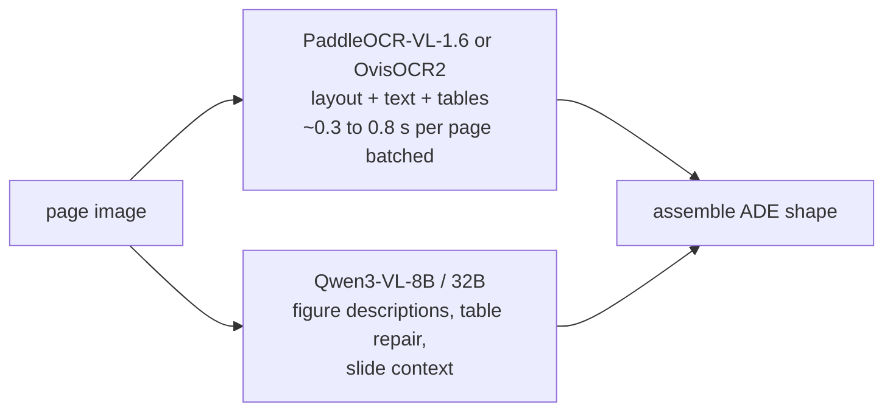

Build
{ .eyebrow }

# Model candidates

Qwen-family vision-language models and the specialised document parsers from Hugging Face that beat them on parsing benchmarks, with code and published results.
{ .lead }

!!! warning "No Korean parsing benchmark exists in public"
    Every number on this page is OmniDocBench (Chinese and English pages), olmOCR-bench (English), or a vendor's own test set. Korean slide parsing has no public leaderboard. Use these numbers to shortlist, then measure on your own decks with the [evaluation recipe](evaluation.md). Where a model's Korean support is confirmed by its authors it says so below; where it is not, it says that too.

## The shortlist

| Model | Size | Role in the pipeline | Korean OCR | License | Published result |
|---|---|---|---|---|---|
| [Qwen3-VL-8B-Instruct](https://huggingface.co/Qwen/Qwen3-VL-8B-Instruct) | 8B dense | general reader: figures, tables, layout prompt, context | yes, 32 OCR languages; Korean named since Qwen2-VL | Apache-2.0 | 235B-A22B sibling: 89.78 on OmniDocBench v1.6 (Roboflow leaderboard summary); MMLongBench-Doc 57.0 (tech report) |
| [Qwen3-VL-32B-Instruct](https://huggingface.co/Qwen/Qwen3-VL-32B-Instruct) | 32B dense | higher-quality reader when one 80 GB card is available | same | Apache-2.0 | "beats Gemini-2.5-Flash and GPT-5-mini on most document metrics" (tech report, no per-benchmark numbers in text) |
| [Qwen3.5-27B](https://huggingface.co/Qwen/Qwen3.5-27B) | 27B dense, native multimodal | reader plus context model in one | 201 languages (text); OCR list not published | Apache-2.0 | OmniDocBench 1.5: 88.9, OCRBench 89.4, CC-OCR 81.0, MMLongBench-Doc 60.2 (model card) |
| [Qwen3.8-27B](https://huggingface.co/Qwen/Qwen3.8-27B) | 27B dense, native VL, hybrid attention | same, newest; thinking on by default | not stated | Apache-2.0 | OmniDocBench 1.5: 91.1 (model card) |
| [PaddleOCR-VL-1.6](https://huggingface.co/PaddlePaddle/PaddleOCR-VL-1.6) | 0.9B | fast whole-page parser: layout, text, tables, formulas | 109 languages claimed for the family (paper); verify Korean on your pages | Apache-2.0 | OmniDocBench v1.6: 96.33 (model card) |
| [OvisOCR2](https://huggingface.co/ATH-MaaS/OvisOCR2) | 0.8B | fast whole-page parser | not stated | see card | OmniDocBench v1.6: 96.58 (tech report, self-reported) |
| [HPD-Parsing](https://huggingface.co/PaddlePaddle/HPD-Parsing) | 1B | fastest parser: hierarchical parallel decoding | tagged en/zh only | Apache-2.0 | OmniDocBench v1.6: 94.91; 2.68 pages/s batched on one A800 (model card) |
| [dots.ocr / dots.mocr](https://github.com/studio-dots-ai/dots.ocr) | ~3B (1.7B LLM) | single-model layout + recognition with JSON boxes | "virtually any script"; Korean not named | MIT + license file | OmniDocBench v1.5 Elo 1027 / 1059; olmOCR-bench 79.1 / 83.9 |
| [DeepSeek-OCR](https://huggingface.co/deepseek-ai/DeepSeek-OCR) | 3B | cheap bulk parser | "nearly 100 languages" (HF blog) | MIT | OmniDocBench v1.5: 87.01 (PaddleOCR-VL-1.5 paper table); 200k pages/day on one A100 40 GB (HF blog) |
| MinerU2.5-Pro, GLM-OCR | 1.2B, small | parsers with explicit two-stage design | not verified | see cards | OmniDocBench v1.6: 95.75 and 95.22 (Roboflow leaderboard summary) |

Sources: [Qwen3-VL README](https://github.com/QwenLM/Qwen3-VL), [Qwen3-VL technical report](https://arxiv.org/abs/2511.21631), [Qwen2-VL blog](https://qwenlm.github.io/blog/qwen2-vl/) ("most European languages, Japanese, Korean, Arabic, Vietnamese"), [Qwen3.5-27B card](https://huggingface.co/Qwen/Qwen3.5-27B), [Qwen3.8-27B card](https://huggingface.co/Qwen/Qwen3.8-27B), [PaddleOCR-VL paper](https://arxiv.org/abs/2510.14528), [OvisOCR2 report](https://arxiv.org/abs/2607.13639), [HPD-Parsing card](https://huggingface.co/PaddlePaddle/HPD-Parsing), [dots.ocr](https://github.com/studio-dots-ai/dots.ocr), [HF open OCR models blog](https://huggingface.co/blog/ocr-open-models), [Roboflow 2026 ranking](https://roboflow.com/blog/best-open-source-ocr-models).

## How to read that table

**The specialised parsers win at transcription.** On OmniDocBench v1.6 the 0.8 to 1.2B parsers score 95 to 96.6 while the 235B Qwen3-VL scores 89.8 and the newest 27B Qwen scores 91.1 on v1.5. They are also five to twenty times cheaper per page. For "read every character on this slide, including the table", start with PaddleOCR-VL-1.6 or OvisOCR2.

**The general Qwen models win at understanding.** Figure descriptions in Korean that name the axis and the number, the table-to-HTML rewrite with merged cells explained, and the slide-context paragraph are instruction-following tasks. The parsers are fine-tuned to emit one fixed format and do not take instructions well. Qwen3-VL-8B is the smallest model that does this reliably; the 27B/32B class is noticeably better at charts.

**Qwen3.5 and Qwen3.8 are not drop-in Qwen3-VL replacements.** They are native multimodal models with a hybrid Gated DeltaNet / Gated Attention stack, "thinking" on by default (Qwen3.8), and at release they required the main branch of transformers and a nightly vLLM. Their document scores are higher than Qwen3-VL's on the model cards, but the serving stack on A100 needs to be verified first ([hardware](hardware.md)).

**Korean is confirmed only for Qwen3-VL by the authors' own language list.** PaddleOCR-VL claims 109 languages and the PaddleOCR family has shipped Korean recognition for years, but the 1.6 card itself lists only English and Chinese tags. Treat Korean quality as unmeasured for every model until you run the eval set.

## The recommended combination



- **Digital decks:** text layer for text, parser for tables, Qwen for figures and context.
- **Scanned decks:** parser for everything on the page, Qwen for figures and context, Qwen re-read for any block the verifier flags.
- **Qwen-only variant** (simplest to operate): Qwen3-VL-8B with the per-block pipeline. Expect it to be within budget on digital decks and to miss the five-second target on dense scanned pages with large tables.

## Code

### Qwen3-VL through vLLM (the pipeline's default)

```bash
pip install "vllm>=0.11" "qwen-vl-utils==0.0.14"
vllm serve Qwen/Qwen3-VL-8B-Instruct \
  --max-model-len 16384 --limit-mm-per-prompt '{"image":4}' \
  --max-num-seqs 64 --gpu-memory-utilization 0.9
```

```python
import base64
from openai import OpenAI

client = OpenAI(base_url="http://localhost:8000/v1", api_key="EMPTY")

def ask(image_path: str, prompt: str, max_pixels: int = 2048 * 32 * 32) -> str:
    b64 = base64.b64encode(open(image_path, "rb").read()).decode()
    rsp = client.chat.completions.create(
        model="Qwen/Qwen3-VL-8B-Instruct", temperature=0.0, max_tokens=4096,
        messages=[{"role": "user", "content": [
            {"type": "image_url", "image_url": {"url": f"data:image/png;base64,{b64}"}},
            {"type": "text", "text": prompt}]}],
        extra_body={"mm_processor_kwargs": {"max_pixels": max_pixels}},
    )
    return rsp.choices[0].message.content

layout_html = ask("slide-012.png", "qwenvl html")            # element boxes as data-bbox="x0 y0 x1 y1" in 0..1000
markdown    = ask("slide-012.png", "qwenvl markdown", 4608 * 32 * 32)  # page markdown, tables as LaTeX with coordinates
```

The two built-in prompts come from the [Qwen3-VL document-parsing cookbook](https://github.com/QwenLM/Qwen3-VL/blob/main/cookbooks/document_parsing.ipynb); `data-bbox` coordinates are relative to 1000, which `pipeline/korean_slides/route.py` converts to ADE's 0..1 boxes.

### Qwen3-VL through transformers

```python
import torch
from transformers import AutoModelForImageTextToText, AutoProcessor
from qwen_vl_utils import process_vision_info

model_id = "Qwen/Qwen3-VL-8B-Instruct"
model = AutoModelForImageTextToText.from_pretrained(model_id, dtype=torch.bfloat16, device_map="auto",
                                                    attn_implementation="flash_attention_2")
processor = AutoProcessor.from_pretrained(model_id)

messages = [{"role": "user", "content": [
    {"type": "image", "image": "slide-012.png", "min_pixels": 512*32*32, "max_pixels": 2048*32*32},
    {"type": "text", "text": "이 표를 HTML <table>로 변환하세요. 병합된 셀은 rowspan/colspan으로 표현하세요."}]}]
text = processor.apply_chat_template(messages, tokenize=False, add_generation_prompt=True)
images, videos = process_vision_info(messages, image_patch_size=16)
inputs = processor(text=[text], images=images, videos=videos, do_resize=False, return_tensors="pt").to(model.device)
out = model.generate(**inputs, max_new_tokens=2048, do_sample=False)
print(processor.batch_decode(out[:, inputs.input_ids.shape[1]:], skip_special_tokens=True)[0])
```

### PaddleOCR-VL-1.6 (whole-page parser)

```python
# pip install "paddleocr[doc-parser]"   (or the vLLM route in the model card)
from paddleocr import PaddleOCRVL

pipeline = PaddleOCRVL(pipeline_version="v1.6")
for res in pipeline.predict("slide-012.png"):
    res.save_to_markdown(save_path="out/slide-012")   # markdown with HTML tables
    res.save_to_json(save_path="out/slide-012")       # blocks with boxes and categories
```

### HPD-Parsing (fastest; batched, with multi-token prediction)

```python
import torch
from transformers import AutoModel, AutoTokenizer
from image_preprocess import load_image   # from the model repo

MODEL = "PaddlePaddle/HPD-Parsing"
model = AutoModel.from_pretrained(MODEL, torch_dtype=torch.bfloat16, trust_remote_code=True).eval().cuda()
tok = AutoTokenizer.from_pretrained(MODEL, trust_remote_code=True, use_fast=False)
pixel_values = load_image("slide-012.png").to(torch.bfloat16).cuda()
print(model.generate_hpd(tok, pixel_values, "document parsing with fork.", dict(max_new_tokens=8000)))
```

### dots.ocr (layout + text in one JSON)

```bash
# weights into a directory without dots in its name, then a vLLM server (official integration since vLLM 0.11)
python3 dots_mocr/parser.py slide-012.png --prompt_mode prompt_layout_all_en
# -> JSON list of {bbox, category, text}; text is Markdown, tables HTML, formulas LaTeX
```

### Any parser as a drop-in reader for the pipeline

`pipeline/korean_slides/read.py` talks to an OpenAI-compatible endpoint. To use a parser that is served by vLLM (PaddleOCR-VL's `genai_server`, dots.ocr, OvisOCR2), point `--vlm-base-url` at it for the layout and table calls and keep the Qwen endpoint for figures and context; the two-endpoint split is a ten-line change in `ReaderConfig`.

## Published results, with their caveats

| Benchmark | What it measures | Best open result seen | Caveat for Korean slides |
|---|---|---|---|
| OmniDocBench v1.6 | end-to-end page parsing, zh/en, with a 296-page Hard subset | OvisOCR2 96.58, PaddleOCR-VL-1.6 96.33, MinerU2.5-Pro 95.75 | no Korean, no slides; scores above 95 are near saturation ([FinixDoc](https://arxiv.org/abs/2608.22842) argues the benchmark no longer separates models on hard finance pages) |
| OmniDocBench 1.5 | same, earlier version | Qwen3.8-27B 91.1, Qwen3.5-27B 88.9, Qwen3-VL-235B-A22B 84.5 to 89.8 depending on the summary | leaderboard summaries mix 1.5 and 1.6 numbers; compare only within a version |
| olmOCR-bench | unit-test style checks on English PDFs | Chandra 83.1, olmOCR-2 82.3, dots.mocr 83.9 | English only |
| CC-OCR | multilingual OCR incl. non-Latin | Qwen3.5-27B 81.0, Qwen3-VL-235B 81.5 | the only multilingual document benchmark the Qwen cards report; its page quality is low |
| MMLongBench-Doc | long multi-page document QA | Qwen3.5-27B 60.2, Qwen3-VL-235B 57.0 | closest proxy for "understand the deck", not a parsing metric |
| Qwen in-house multilingual OCR | per-language accuracy | "over 70% on 32 of 39 languages" (tech report) | the per-language table is a figure in the report; Korean's number is not in the text |

If one number has to be remembered: a 1B parser at 96 on OmniDocBench and an 8B general VLM at roughly 88 to 90 are not the same tool. Use both.
