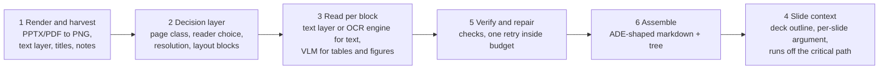

Build
{ .eyebrow }

# Korean slides pipeline

Six stages that turn a dense Korean slide deck into ADE-shaped output (markdown + structure tree + grounding) with open-weight models, inside a five-second-per-slide budget.
{ .lead }

Reference code: [`pipeline/korean_slides/`](https://github.com/swchoi1994/agentic-doc-parsing-wiki/tree/main/pipeline/korean_slides) in the repo. It runs end to end today with `--dry-run` (stub reader, no GPU) and against any OpenAI-compatible VLM server.

## Why slides are the hard case

A person reads a slide with context: the title frames it, the section it belongs to was announced three slides ago, the chart proves the bullet next to it, the footnote qualifies the number, and the speaker said the rest out loud. A model given one rendered slide sees none of that, and dense Korean decks add four failure modes of their own:

| What the slide has | What goes wrong in a single VLM call |
|---|---|
| 8 to 10 pt Hangul in two columns, 60+ lines | Too few pixels per glyph at the default resolution; skipped lines; the generative reader **collapses** into repetition on the densest pages |
| Borderless tables with merged header cells | Rows shift, headers drift, cells get invented |
| Charts with three-word legends | Descriptions that restate the title and miss the number that matters |
| Meaning that depends on the previous slide and the speaker notes | Correct transcription, wrong understanding |

ADE answers the first three with a layout stage, per-block reading, a dedicated table path and generated figure descriptions ([how DPT-3 works](../ade/how-dpt3-works.md)). It does not answer the fourth: ADE reads one page at a time and never sees speaker notes. This pipeline copies the first three and adds a slide-context stage for the fourth.

## The pipeline



<ol class="stages" markdown>

<li markdown id="stage-1-render-and-harvest">
**Render and harvest.** Convert PPTX to PDF once per deck with LibreOffice, rasterise each page at 200 DPI (about 2200 px wide for 16:9, enough for 8 pt Hangul), and keep three things ADE throws away: the PDF text layer with span boxes, the slide titles, and the speaker notes from the PPTX XML. For digitally authored decks the text layer is exact and costs nothing. Scanned decks have none of it and fall through to the VLM. Code: `render.py`.
</li>

<li markdown>
**Decision layer: route and detect layout.** Two cheap signals classify the page: *does it have a text layer* (digital vs scan) and *ink density* from the rendered PNG (dense vs normal). The class picks the reader for text blocks (text layer, OCR engine, or VLM), the image resolution budget (`max_pixels`), and whether big blocks get cut at whitespace valleys before reading. Then a layout detector produces typed blocks in reading order. The default asks Qwen3-VL for its `qwenvl html` output (element boxes in 0..1000 coordinates) and maps the element classes onto ADE's nine block types; for the five-second budget on dense pages, swap in a convolutional detector (DocLayout-YOLO, PP-DocLayoutV3, ~30 ms a page) and keep the VLM for reading. Code: `route.py`.

This is the "CNN" question from the design discussion answered concretely: the detector is a convolutional or DETR model, the density and projection-profile checks are classical CV, and together they decide *what* to read with *which* reader. The layout-priors paper measured the value of exactly this split: feeding RT-DETR boxes to a 258M VLM raised markdown F1 from 0.37 to 0.92 on structurally novel documents at about 15% extra latency ([arXiv 2605.19866](https://arxiv.org/abs/2605.19866)).
</li>

<li markdown>
**Read per block.** Each non-text-layer block is cropped at native resolution with a small pad and sent to the VLM with a type-specific Korean prompt: text to Markdown, tables to HTML with `rowspan`/`colspan`, figures to a three-to-six-sentence Korean description that must name axes, legends, units and the numbers. Blocks run concurrently through vLLM's continuous batching, so wall time per slide is the slowest block, not the sum. Reading crops instead of the whole page is what keeps the generative reader out of collapse and lets stage 5 retry one block. Code: `read.py`.
</li>

<li markdown>
**Slide context.** After a deck is assembled, a text LLM (the same vLLM server if the VLM is instruction-tuned) builds a deck outline (topic, 3 to 7 sections, which slides belong where) and then writes, for every slide, a Korean paragraph of *what this slide argues and on what evidence*, given the slide's markdown, its title, its speaker notes, and the first lines of the previous and next slides. The result is `context.json`, and at retrieval time it is prefixed to each slide's chunks so a retriever and a reader get the context a human had. This runs off the critical path: slide *n*'s context is written while slide *n+1* is being read. Code: `context.py`.
</li>

<li markdown>
**Verify and repair.** Deterministic checks per block: 3-gram repetition ratio (collapse shows up above 0.3), length against the expectation from crop area and ink density, Hangul share among letters (near zero on a Korean slide is a misread), agreement with the text layer when one exists, and ragged row lengths for tables. The checks are the easy part. The **policy** that turns flags into an action (accept, re-read the crop at higher resolution, split the crop at whitespace valleys and re-read the parts, or flag for a human) is the heart of ADE's "verify until a quality threshold is met" behaviour, and it depends on your documents and budget. It is left as one function for you to write, with a trivial default so the pipeline still runs. Code: `verify.py`, function `decide()`.

!!! tip "The one function to write yourself"
    `pipeline/korean_slides/verify.py` has `decide(result, block) -> "accept" | "reread-hires" | "split-reread" | "flag"` with the checks already computed in `result`. Five to ten lines decide which flags earn a retry, when higher resolution beats splitting (small glyphs without collapse: resolution; collapse or too-short on a big block: split), how many retries fit in the five-second budget, and whether a block that disagrees with the text layer should simply be replaced by it. The [Collapse, Not Complexity](https://arxiv.org/abs/2609.23592) paper is the best published guide: detect collapse from the first pass, decompose by projection, re-parse, and expect a gain of 1.4 to 2.4 points overall at 1.13x tokens.
</li>

<li markdown>
**Assemble.** One markdown string in reading order, pages separated by `<!-- PAGE BREAK -->`, `<figure type="FIGURE"><description>…</description></figure>` for figures, bracketed labels for attestations and scan codes, ids `<type>-<index>` per type, `range` in Unicode code points into the string, boxes rounded to five decimals, table cells as `table_cell` children with `row`/`col`/`rowspan`/`colspan`, and a trailing `<!-- doc_id=… -->`. Downstream code written against ADE Gen2 reads this unchanged. Code: `assemble.py`, `ade_schema.py`.
</li>

</ol>

## The five-second budget

The target is five seconds of wall time per slide. These are **planning estimates for one A100 80 GB running an 8B VLM in vLLM at BF16**, not measurements; the [evaluation recipe](evaluation.md) includes the timing harness that replaces them with your numbers.

| Stage | Digital deck (text layer present) | Scanned deck | Notes |
|---|---|---|---|
| 1 Render and harvest | 0.1 to 0.3 s | 0.1 to 0.3 s | LibreOffice conversion is per deck, about 0.2 s per slide amortised |
| 2 Decision layer | 0.05 s with a detector; 1.5 to 3 s if the VLM does layout | same | Use the detector when the budget is tight; the VLM layout prompt is the slow path |
| 3 Read: text blocks | 0 s (text layer) | 0.5 to 1.5 s (OCR engine or 1B parser, batched) | PaddleOCR-VL-1.6 and OvisOCR2 class models parse whole pages in well under a second batched; see [models](models.md) |
| 3 Read: tables (VLM, HTML out) | 1.5 to 4 s | 1.5 to 4 s | The critical path. 300 to 800 output tokens at roughly 100 to 200 tokens/s per sequence on an 8B model; cap table reads at one per slide in parallel with the rest, or route tables to the 1B parser |
| 3 Read: figures (VLM description) | 1 to 2 s | 1 to 2 s | 150 to 300 output tokens; runs concurrently with tables |
| 5 Verify | 0.01 s | 0.01 s | one retry only if at least 2 s of budget remain |
| 6 Assemble | 0.01 s | 0.01 s | |
| **Critical path** | **about 2 to 4.5 s** | **about 3 to 5.5 s** | Scanned dense pages with a big table are the ones that miss; route them to the specialised parser |
| 4 Slide context (off path) | 1 to 2 s | 1 to 2 s | pipelined with the next slide; does not count toward the five seconds unless you need it synchronously |

Three consequences for the design:

1. **Do not let the VLM read what the file already knows.** On digital decks the text layer takes the largest block of work off the GPU.
2. **Route tables and whole-page text to a specialised parser, keep the general VLM for figures and context.** The 0.8 to 1B parsers are both more accurate on OmniDocBench and several times faster than an 8B general VLM for transcription; the general VLM wins at instruction following, which is what figure descriptions and the context pass need.
3. **Make the budget visible to the retry policy.** `decide()` should receive the remaining budget, so a second pass on one block happens only when it still fits.

For model routing at the serving layer (small model for digital pages, bigger model for dense scans, with one endpoint), see the semantic-router note on the [hardware page](hardware.md#routing-with-vllm-semantic-router).

## Prompts

The prompts are Korean, because the output must be Korean and the model's instruction-following is better when the instruction and the expected output share a language. From `read.py`:

```text
text:    이 이미지의 모든 텍스트를 보이는 순서대로 Markdown으로 정확히 옮겨 적으세요. 제목은 #, 글머리 기호는 -,
         강조는 **굵게**로 표시하고, 없는 내용을 추가하지 마세요. 한글 맞춤법과 띄어쓰기는 원문 그대로 유지합니다.
table:   이 표를 HTML <table>로 변환하세요. 병합된 셀은 rowspan/colspan으로 표현하고, 모든 셀 내용을 빠짐없이
         원문 그대로 적으세요. 표 바깥 설명은 쓰지 말고 HTML만 출력하세요.
figure:  이 그림(차트/도식/사진)을 한국어로 설명하세요. 차트라면 축, 범례, 단위, 수치와 추세를 구체적으로 적고,
         도식이라면 구성 요소와 화살표 관계를 적으세요. 3~6문장, Markdown 없이 서술합니다.
layout:  qwenvl html        (Qwen3-VL's built-in document-parsing prompt; boxes in 0..1000)
```

And the context stage, which is the part no parsing API offers:

```text
당신은 이 슬라이드 덱을 발표자처럼 이해하는 분석가입니다. 아래 정보를 바탕으로 이 슬라이드가 주장하는
핵심 메시지와 그 근거를 한국어 3~5문장으로 요약하세요. 숫자와 고유명사는 원문 그대로 인용하고,
슬라이드에 없는 내용은 추측하지 마세요.
[덱 주제] … [섹션] … [이전 슬라이드 요지] … [다음 슬라이드 요지] … [발표자 노트] …
[이 슬라이드의 파싱 결과] …
```

## Resolution, in numbers

Qwen3-VL uses 16 px patches merged 2x2, so one visual token covers a 32x32 px block. A 1920x1080 render is about 2,025 tokens; the cookbook's document-parsing settings are `min_pixels = 512·32²` and `max_pixels = 2048·32²` for HTML layout and `4608·32²` for markdown. Dense 8 pt Hangul at 200 DPI is about 22 px tall, so a whole-page read at the default budget leaves roughly one token per two glyphs. Reading a cropped block at native resolution is how the pipeline gets back to several tokens per glyph without paying for the whole page at that density.

## Running it

```bash
# one-time
python3 -m venv .venv && .venv/bin/pip install -r pipeline/requirements.txt
# a VLM server, e.g. on one A100 80 GB
vllm serve Qwen/Qwen3-VL-8B-Instruct --max-model-len 16384 --limit-mm-per-prompt '{"image":4}' --max-num-seqs 64
# parse a deck
.venv/bin/python -m pipeline.korean_slides.run deck.pptx --out out/deck \
    --vlm-base-url http://localhost:8000/v1 --vlm-model Qwen/Qwen3-VL-8B-Instruct
# exercise the whole path without a GPU
.venv/bin/python -m pipeline.korean_slides.run deck.pdf --out out/deck --dry-run
```

Outputs: `parse-response.json` (ADE shape), `parse-output.md`, `pages/*.png`, `context.json`, `verify.jsonl`.

## What this does not do yet

- The shipped `run.py` asks the VLM for layout on scanned and dense pages only; digital pages use the text layer for text and run the VLM layout pass at the default resolution just to find tables and figures. A convolutional detector backend is the first swap to make for the five-second budget on scanned decks.
- There is no OCR-engine reader in the code yet (the Verity-style path with per-word confidence); text comes from the text layer or the VLM.
- Per-cell boxes inside tables: cells carry the table's box. A cell-level detector (or PaddleOCR's table structure model) would give ADE's `table_cell` grounding.
- Word-level grounding with confidence: only an OCR-engine reader (PaddleOCR text recognition, or a Verity-style model) can supply it; the VLM path grounds at block level.
- Automatic Pro/Verity-style routing per page is a heuristic (text layer + ink density). A trained page classifier is the next step; see the semantic-router note on the [hardware page](hardware.md).
